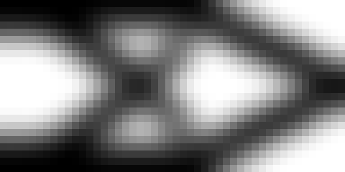
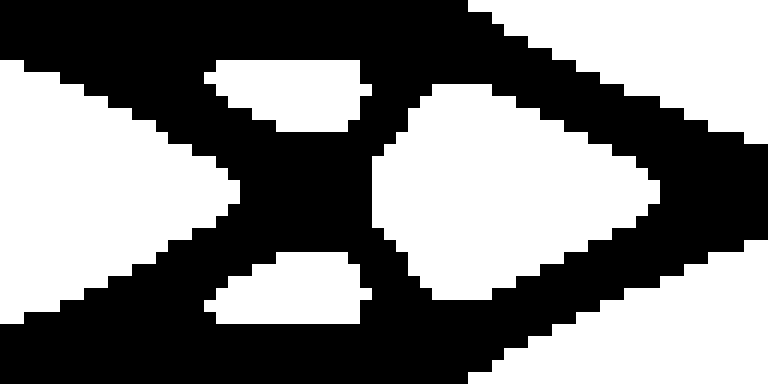

# Topology optimization · FEM + machine learning

[](https://github.com/mitjasha/Topology-optimization/actions/workflows/verify.yml)
[](LICENSE)

**Can a learned warm start reduce optimization effort without sacrificing structural performance?**

A reproducible CAE case study combining finite-element analysis, topology optimization and physics-checked machine learning. Start with the numerical evidence, inspect the assumptions, then reproduce the experiment on a CPU.

| Continuous-density reference | Projected binary candidate |
|:---:|:---:|
|  |  |
| Filtered SIMP, 50% material | Projection continuation, 50% material |

*Two separate studies, with different meshes and optimization settings. These images illustrate the workflow; they are not a controlled before/after comparison or manufactured parts.*

**Early FEM iterations → ridge / U-Net prediction → FEM checks → OC refinement → acceptance or full-solve fallback**

[**Run on Windows**](RUN_WINDOWS_EN.md) · [**Инструкция на русском**](RUN_WINDOWS_RU.md) · [**Experiment protocol**](docs/development-v2.md) · [**Technical review**](docs/release-review-v2.md)

## Topology Lab — graphical research workbench

**[English guide](docs/GUI_EN.md) · [Русская инструкция](docs/GUI_RU.md)**

An optional local Streamlit application provides English/Russian navigation, dataset
generation, supervised and diffusion-model training, multi-seed comparative studies,
neural FEM evaluation, live job logs, and interactive analysis of actual results.
CLI tools and frozen numerical baselines remain independently usable.

```bash
python -m pip install -r requirements-gui.txt
python -m streamlit run topopt/mlnext/gui.py
```

Alternatively start `run_topology_lab.cmd` (Windows) or
`bash run_topology_lab.sh` (Linux/macOS) after installing GUI dependencies.
The app runs locally at `http://localhost:8501` and is not intended for
public network exposure. Heavy model training has not been performed by adding this UI.


## Scientific ML research track (experimental)

A separately reproducible [Scientific ML Suite](docs/scientific-ml-roadmap.md)
extends the existing numerical optimizer without replacing its verified Ridge/U-Net evidence.
The suite includes BC/geometry-conditioned residual U-Net, graph message passing,
Fourier neural operators, a differentiable compliance-based loss, learned density
updates, a neural initial guess for Jacobi-preconditioned FEM-CG, and conditional
diffusion/transformer design sampling.

Start with `python -m pip install -r requirements-mlnext.txt`,
`python -m pytest mltests/test_mlnext.py -v`, and
`python scripts/mlnext_experiment.py --quick --dry-run`.
No improvement beyond the previously published Ridge/U-Net benchmark is claimed
until held-out, physics-gated comparisons finish. The research workflow and its
limitations are documented separately from the historical evidence.

## Results at a glance

The extended learning experiment uses **84 cases: 48 training, 12 validation and 24 held-out test cases**. The test family has a new rectangular aspect ratio, L/H = 2.5; all cases retain cantilever supports. Three network initialization seeds and three timing repeats give 216 evaluations per method, not 216 independent test problems.

| Method | Mean FEM solves per test run | Final quality gate |
|---|---:|---:|
| Uniform-start OC | 48.25 | 216 / 216 |
| Ridge warm start + OC | **27.00** | 216 / 216 |
| Small U-Net warm start + OC | 36.28 | 216 / 216 |

**Engineering decision:** retain ridge as the stronger baseline in this experiment. It uses about **44% fewer online FEM solves** than uniform-start OC; U-Net uses about **25% fewer**. These counts include early iterations, checks and refinement. Offline label generation and training are separate costs. Short CPU timings do not establish an industrial speedup.

Source: [per-run results](evidence_v2/families/results.csv), [summary](evidence_v2/families/summary.json), [split, settings and provenance](evidence_v2/families/manifest.json).

## What has been verified?

| Engineering question | Evidence and conclusion |
|---|---|
| Does the numerical implementation behave consistently? | 31 tests cover equilibrium, energy, sensitivities, dense/sparse agreement, projection gradients, split isolation and failed acceptance gates. The optional network test requires PyTorch. |
| Does another solver agree? | CalculiX binary comparisons at thickness 0.001 differ in compliance by about 0.175% and 0.083%. All eight runs at thickness 0.001 and 0.0001 pass; two of twelve total comparisons fail at thickness 0.01. [Evidence](evidence_v2/binary_correlation/summary.json). |
| Are the results mesh independent? | **Not yet.** Frozen-field compliance still changes 2.387% at the final refinement to 128×64. [Study](evidence_v2/refinement/summary.json). |
| Can a binary candidate pass the defined checks? | Two projected candidates pass volume, compliance, connectivity and void-stiffness sensitivity gates. This does not establish manufacturability. [Protocol](docs/development-v2.md). |
| What happens when a prediction fails? | The extended benchmark executes and counts a full uniform-start solve when the runtime gate fails. The decision uses quantities available at runtime, not the held-out reference solution. |

This is a **research demonstrator** for linear plane-stress elasticity. Stress limits, buckling, fatigue, manufacturing constraints and industrial qualification are outside the demonstrated scope. Independent solver correlation is numerical verification, not experimental validation.

## Reproduce in a few commands

Use Python 3.12. The core workflow needs NumPy and SciPy; it requires no GPU, solver license or historical dataset.

```powershell
git clone https://github.com/mitjasha/Topology-optimization.git
cd Topology-optimization
py -3.12 -m venv .venv
.\.venv\Scripts\python.exe -m pip install -r requirements-reproduce.txt
.\run_checks.cmd
```

Open `my_results/report.html` and `my_mesh_study/report.html` locally. The quick workflow runs tests, the strict 24-case ridge benchmark and the foundation mesh/binary study. It does **not** run the extended U-Net or external CalculiX experiments. For those, follow [the extended experiment commands](docs/development-v2.md); PyTorch and CalculiX are optional additional dependencies.

On Linux/macOS, create and activate a Python 3.12 virtual environment, then:

```bash
python -m pip install -r requirements-reproduce.txt
python -m topopt.evidence --output my_results
python -m topopt.mesh_study --output my_mesh_study
```

GitHub Actions runs the core numerical verification on Windows and Linux. HTML reports must be opened locally; GitHub displays their source.

## Engineering approach

- **Mechanics:** bilinear Q4 elements, 2×2 Gauss integration, small-displacement isotropic plane stress, nondimensional E = 1 and unit thickness.
- **Optimization:** minimum compliance, SIMP penalization, physical density filtering and OC updates; smooth projection continuation for the extended binary study.
- **Implementation:** dense NumPy reference and sparse SciPy stiffness/filter backends, with comparison tests.
- **Learning:** ridge and a small CPU U-Net; validation-based selection, grouped splits and a held-out aspect-ratio family.
- **Acceptance:** convergence, physical volume, equilibrium and compliance; explicit fallback costs and preserved failures.
- **Traceability:** datasets, split IDs, model weights, source snapshots, hashes, solver decks and per-run results.

The case study demonstrates engineering judgment through model assumptions, measurable acceptance criteria, comparison with a simpler baseline and explicit limits on release readiness.

## Explore the repository

| Path | Contents |
|---|---|
| [topopt/](topopt) | FEM, optimization, learning and verification code |
| [tests/](tests) | Numerical and workflow regression tests |
| [evidence_v2/](evidence_v2) | Extended experiments and frozen source snapshots |
| [results/](results), [mesh_study/](mesh_study), [correlation/](correlation) | Preserved foundation evidence; distinct from the extended runs |
| [Engineering specification](docs/engineering-spec.md) | Foundation assumptions and acceptance criteria |
| [Development protocol](docs/development-v2.md) | Extended methods, commands and limitations |
| [Historical notebook review](docs/legacy-review.md) | Context and reproducibility limits of the 2019 work |
| [English historical notebook](20190505_Shakhrai_DS_Topology_Optimization.en.ipynb) | Translated companion to the unchanged original |

## Historical work and attribution

The original [2019 notebook](20190505_Shakhrai_DS_Topology_Optimization.ipynb) is preserved unchanged. It explores U-Net, LinkNet and transfer learning on 32×32 density fields. The original `libtopology`, `X.npz` and trained checkpoints are not present in the public repository as inspected on 2026-10-13. The new solver and dataset must not be represented as recovered historical artifacts.

Methodological reference: Andreassen et al., *Efficient topology optimization in MATLAB using 88 lines of code* (2011), [DTU project page](https://www.topopt.mek.dtu.dk/apps-and-software/efficient-topology-optimization-in-matlab). The current FEM code is independently implemented using isoparametric integration; the referenced MATLAB source is not bundled or copied. SIMP, density filtering and OC are established methods, not original inventions of this project.

The foundation code/documentation was prepared with AI assistance and reviewed using the included numerical checks. The owner should review and understand the implementation before presenting it as portfolio work. Original project software and documentation are licensed under MIT; see LICENSE and NOTICE for third-party material.
